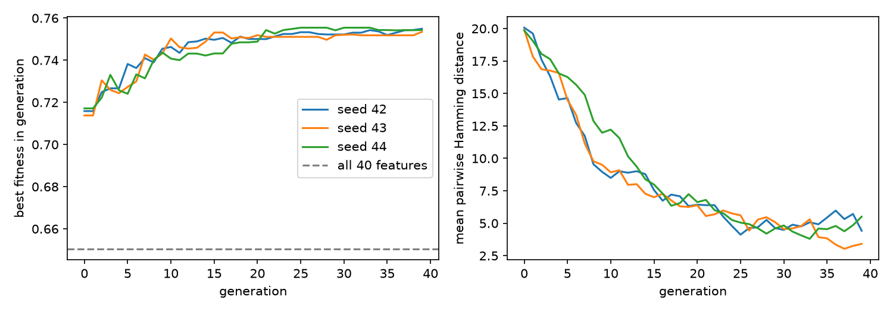

# W07 — Genetic Algorithms and Bayesian Networks

GA = `GA.pdf`, BN = `BayesNetIntroduction.pdf`.

## Question I am trying to answer

**Question:** Is one GA run reliable enough to conclude which feature subset is good?

**Hypothesis:** I did not write a hypothesis before the experiment, so I have none to report.

## A. Concept capsule

**GA.** A GA evolves a population of bit-string hypotheses (GA p.5, p.10–12); my chromosome has one bit per candidate feature. Fitness scores each one (GA p.18). Selection picks parents in proportion to fitness (GA p.7), crossover recombines a pair into two offspring (GA p.8, p.13–16), and mutation inverts a random bit in m percent of the new hypotheses (GA p.9).

**Bayesian network.** A BN represents P(X1,…,Xn) = ∏ P(Xi | Pa(Xi)) (BN p.14). One factor per node, given its parents.

**NB vs TAN.** Naive Bayes gives each feature only the class as parent. TAN allows at most one extra feature parent per feature, and these edges form a tree. This comes from the drill (Q4), not from these slides.

## B. Worked example by hand

Drill Q1, corrected. Edges: S→P, S→R, P→W, R→W, W→L. Five nodes give five factors (BN p.14):

P(S, P, R, W, L) = P(S) · P(P|S) · P(R|S) · P(W|P,R) · P(L|W)

## C. Code-to-theory trace

| Concept | Slide | `ga.py` function | Difference |
|---|---|---|---|
| Representation | GA p.10–12 | `make_pool`, `decode` | 40-bit feature mask, not a rule |
| Fitness | GA p.18 | `fitness` | Macro-F1 (GroupKFold by subject) minus 0.05·k/40 |
| Selection | GA p.7 | `tournament_select` | tournament of 3, not proportional |
| Crossover | GA p.16 | `uniform_crossover` | p_c = 0.9 |
| Mutation | GA p.9 | `bitflip_mutation` | each bit flips with p = 1/40 |
| Diversity | not in slides | `hamming_diversity` | mean pairwise Hamming distance |

Final code: `559093a`. The first version, `9c8a822` (188 lines), hand-wrote GroupKFold, Gaussian NB and Macro-F1; I cut it to 94 lines with sklearn.

## D. Controlled experiment

Only the GA seed changes. Fixed: 40-column pool, population 30, 40 generations, λ = 0.05.

| Seed | Best fitness | Features |
|---|---|---|
| 42 | 0.7549 | 14 |
| 43 | 0.7534 | 13 |
| 44 | 0.7554 | 13 |

Mean 0.7546, std 0.0010. All 40 features: 0.6505. Jaccard of the selected columns: 0.69, 0.69 and 0.86 (42–43, 42–44, 43–44). Diversity falls from about 20 to 3.41–5.51.

Fitness is stable, but the subsets overlap only partly. One run supports "a subset beats all 40", not "these are the good columns". Fitness is a train-CV score, so optimistic; the test split is sealed.

## E. Failure / misconception

**Q1.** I wrote 4 factors for 5 nodes and left out P(R|S). Source: BN p.14.

**Q2.** For "P ⟂ R | S" I dropped "| S" and checked only P ← S → R, missing P → W ← R. The observed fork S blocks the first path; the unobserved collider W (and descendant L) blocks the second. Source: Murphy (2022), Ch. 3, as recorded in my corrections.

## F. Written-exam capsule

**Q (4 marks):** When is a path blocked in d-separation, given evidence Z?

**A:** A chain or fork through B is blocked iff B ∈ Z. A collider at B is blocked iff neither B nor a descendant is in Z. X ⟂ Y | Z iff every path is blocked.

## G. Reflection

- **Can now explain:** why a BN needs one factor per node; why fitness is stable across seeds while subsets are not.
- **Not sure yet:** why the subsets differ, and whether 40 generations are enough.
- **Will test next:** more seeds and generations, then the sealed test once.

## H. Inquiry trail

- **Asked the AI:** draft 4 BN/TAN drill questions; review the drill after `2252515`; review ga.py (too complex, and I simplified it myself); outline of this post.
- **Pre-AI attempt:** drill `2252515`; GA first attempt `9c8a822`.
- **Without AI:** the drill first attempt; the first GA code; the simplification of `ga.py`.
- **Verified against:** GA p.5, p.7–9, p.10–16, p.18; BN p.14. Numbers in D: re-run of `w07_ga_seeds.py`.
